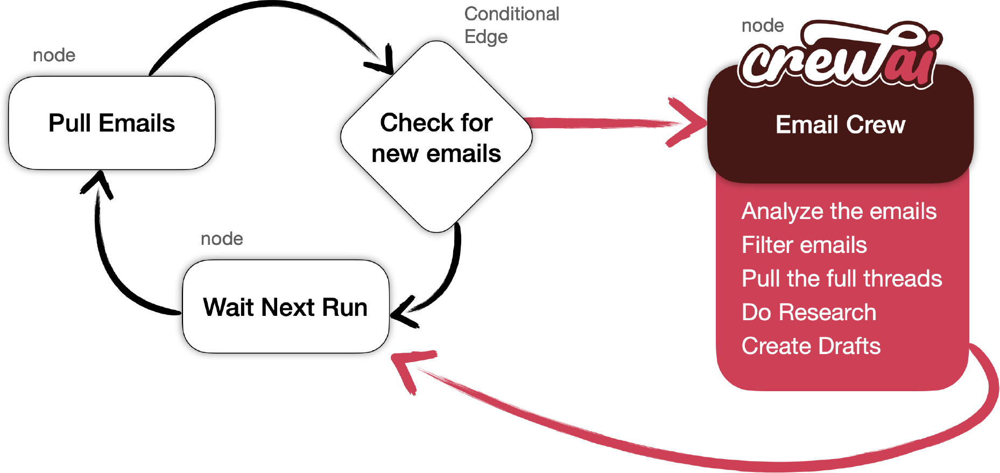

# CrewAI + LangGraph (Optimized with Ponytail)

## Introduction
This is an optimized integration of [CrewAI](https://github.com/crewAIInc/crewAI) with [LangGraph](https://github.com/langchain-ai/langgraph) to automate email triage, priority detection, and draft response generation using Gmail and Tavily.

CrewAI orchestrates specialized collaborative agents, while LangGraph manages the cyclic state machine for polling and conditional execution.



## Ponytail Skill Optimizations Applied
This codebase was streamlined following the **Ponytail 7-Rung Ladder of Laziness** (*"The best code is the code you never wrote"*):
1. **Removed Dead Dependencies**: Eliminated unused packages (`google-search-results`, `beautifulsoup4`) from `requirements.txt`.
2. **Eliminated Redundant Resource Instantiations**: Cached and shared a single `GmailToolkit` instance across tools, nodes, and agents, eliminating expensive repeated API/credential handshakes.
3. **Fixed Buggy State Lookups**: Replaced unsafe dictionary key indexing (`state['checked_emails_ids']`) with `.get()` defaults to prevent `KeyError` crashes on initial graph runs.
4. **Hardened Custom Tools**: Optimized `create_draft` to use safe `split('|', 2)` rather than unbounded splits, preventing crashes when email bodies contain pipe characters.
5. **Deduplicated Email Tracking**: Switched ID lookup from linear array scans to $O(1)$ set lookups, avoiding duplicate ID bloat over time.
6. **Stripped OOP Boilerplate**: Replaced empty class wrappers (`Nodes`, `WorkFlow`, `EmailFilterTasks`) with clean, composable module-level functions while maintaining backwards-compatible class interfaces.
7. **Prompt & Token Efficiency**: Tightened agent backstories and task instructions to eliminate prompt fluff, saving tokens on every run.

## Setup & Running

### 1. Configure Environment
Copy `.env.example` to `.env` and fill in your keys:
```bash
cp .env.example .env
```
Key variables:
- `OPENAI_API_KEY`: Your OpenAI API key.
- `TAVILY_API_KEY`: Your Tavily search API key.
- `MY_EMAIL`: Your email address (prevents the bot from responding to your own emails).
- `EMAIL_POLL_INTERVAL`: Polling interval in seconds (default: 180).

### 2. Set Up Gmail Credentials
1. Follow the [Google Gmail API Quickstart](https://developers.google.com/gmail/api/quickstart/python#authorize_credentials_for_a_desktop_application).
2. Download your desktop credentials and place them as `credentials.json` in the root of this project.

### 3. Install Dependencies
```bash
pip install -r requirements.txt
```

### 4. Run the Automation
```bash
python main.py
```

## Architecture
- `main.py`: Entry point with graceful interrupt handling.
- `src/state.py`: Typed state schema (`EmailsState`).
- `src/graph.py`: LangGraph workflow definition and compilation.
- `src/nodes.py`: Node functions for email search, filtering, and cycle delay.
- `src/crew/crew.py`: CrewAI team assembly and execution.
- `src/crew/agents.py`: Focused agent definitions (Filter Analyst, Action Specialist, Response Writer).
- `src/crew/tasks.py`: Concise task definitions.
- `src/crew/tools.py`: Shared Gmail resource and safe draft creation tool.
- `AGENTS.md`: Agent development instructions adhering to the Ponytail ruleset.

## License
MIT License.
